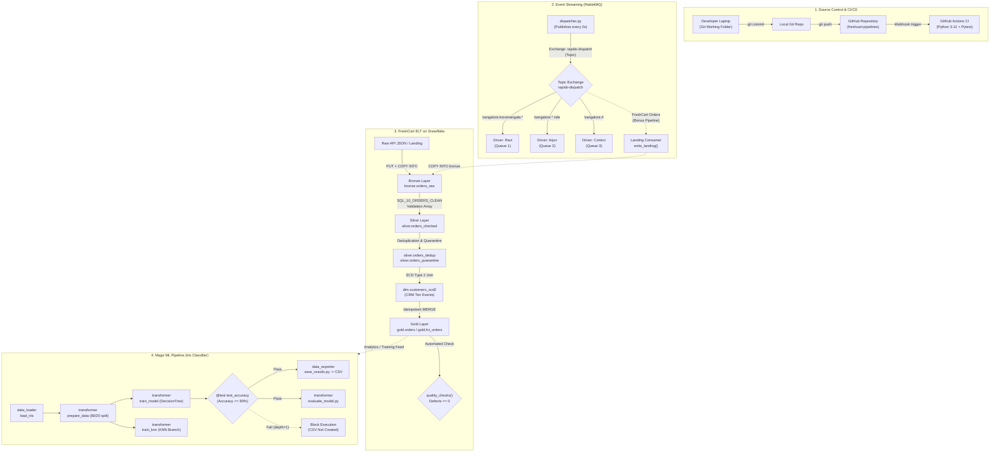

# Assignment: From Git to Gold
**Version control, ELT, ML pipelines and event streaming, end to end**

- **Student Name:** ____________________
- **Roll Number:** ____________________
- **Date:** ____________________
- **Repository URL:** https://github.com/Saumitra-agrahari/DE-Assignment

---

## Part A: Git and CI/CD (15 marks)

### A1. Create the repository (5 marks)
*Paste the output of `git log --oneline` into your report below:*

```text
[Paste your git log --oneline output here]
```

---

### A2. Where does each command act? (4 marks)

| Command | Where the change happens | What exactly happens? (In your own words) |
|---|---|---|
| `git init` | | |
| `git add train.py` | | |
| `git commit -m "msg"` | | |
| `git remote add origin URL` | | |
| `git push -u origin main` | | |
| `git pull origin main` | | |

**Question:** After running `git commit`, can your teammate see your code on GitHub? Why or why not?
> [Student explanation here]

---

### A3. A small CI workflow (6 marks)
- **Screenshot 1:** Green (passing) run in GitHub Actions tab.
  *(Attach image in submission)*
- **Screenshot 2:** Red (failing) run made by temporarily changing `test_size` to 0.3 in `prepare_data.py`.
  *(Attach image in submission)*
- **Screenshot 3:** Commit that fixes it back to 0.2 and restores green status.
  *(Attach image in submission)*

---

## Part B: FreshCart ELT on Snowflake (30 marks)

### B1. Run the baseline (5 marks)

| Check | Expected | Actual Output / Confirmed? |
|---|---|---|
| Raw order rows in bronze after one run | 8 (6 web + 2 mobile) | |
| Rows that pass cleaning (`silver.orders_clean`) | 6 | |
| Rows in quarantine | 2 (ORD-1004, ORD-1006) | |
| Orders after deduplication | 4 | |
| Final gold line | 4 orders, revenue ₹7,785.00, 126 loyalty points | |
| Share of rows rejected | 25% | |

*(Attach output screenshots)*

---

### B2. Trace one record by hand (6 marks)

#### 1. Raw records for ORD-1003 in `bronze.orders_raw`:
> [Student trace here]

#### 2. SQL expressions turning each into `silver.orders_checked`:
> [Student trace here]

#### 3. Surviving copy in `SQL_20_ORDERS_DEDUP` (`QUALIFY ROW_NUMBER()`):
> [Student trace here]

#### 4. Amount and Loyalty Points calculation for ORD-1003:
> [Student trace and arithmetic here]

#### ORD-1005 Loyalty Points Tier Explanation:
> [Student explanation here: table name and join condition responsible]

---

### B3. Add a validation rule (6 marks)
- **Reasons array for ORD-1006 before and after change:**
  - *Before:*
  - *After:*
- **Does the gold total change? Why or why not?**
  > [Student explanation here]
- **Does your new run add a second quarantine row for ORD-1006? Point to SQL part:**
  > [Student explanation here]

---

### B4. Change history and idempotency (7 marks)

| Quantity | Your prediction | Actual after run |
|---|---|---|
| Rows for CUST-02 in `dim.customers_scd2` | | |
| Tier used for ORD-1002 | | |
| Loyalty points for ORD-1002 | | |
| Total loyalty points in gold | | |
| Number of gold rows whose `published_at` changed | | |

**Explanation:** In 4–6 sentences, explain how `row_hash` and the `MERGE` statement make the gold table safe to re-run, and why bronze still grows by 8 rows on every run:
> [Student explanation here]

---

### B5. Add one data-quality check (6 marks)
- **Sixth quality check added:** `gold orders with loyalty_points < 0`
- **Failure output demonstration (failing mock order output):**
  *(Attach screenshot/log output showing PROBLEM detected)*
- **Cleanup confirmation:**
  *(Show query confirming deletion of mock record)*
- **ETL vs ELT for FreshCart:**
  > [Student explanation: why ELT is better for FreshCart, and in which lecture situation ETL still wins]

---

## Part C: ML pipeline with Mage (20 marks)

### C1. Draw and run the pipeline (4 marks)
- **Pipeline block diagram:**
  *(Attach diagram showing block names, types, and attached @test)*
- **Console output of `mage run iris_project iris_classifier --test`:**
  ```text
  [Paste mage run execution output here]
  ```

---

### C2. Tests as a gate (6 marks)

| `max_depth` | Test accuracy | `test_accuracy` passed? | `iris_predictions.csv` created? |
|---|---|---|---|
| 1 | | | |
| 2 | | | |
| 3 | | | |
| 4 | | | |
| 5 | | | |

**Question:** In your own words, explain how a failing `@test` in `train_model` stops `save_results` from running. Why is this better than saving the file and checking it afterwards?
> [Student explanation here]

---

### C3. Add the evaluation branch (5 marks)
- **Edited `metadata.yaml` snippet:**
  *(Show upstream and downstream wiring)*
- **Confusion matrix & classification metrics output:**
  *(Attach screenshot / text output)*
- **Mage UI graph screenshot showing branch:**
  *(Attach screenshot showing save_results and evaluate_model downstream)*

---

### C4. Your own block (5 marks)
- **Description of new block (`train_knn` parallel branch):**
  *(Include block code, purpose, and attached @test)*
- **CI passing confirmation:**
  *(Confirm CI workflow passes with new block)*

---

## Part D: Food-order stream with RabbitMQ (20 marks)

### D1. Routing on paper (6 marks)

| # | Routing key | Receiving queues |
|---|---|---|
| 1 | `bangalore.koramangala.food` | |
| 2 | `bangalore.indiranagar.ride` | |
| 3 | `bangalore.whitefield.ride` | |
| 4 | `chennai.tnagar.food` | |
| 5 | `chennai.whitefield.ride` | |
| 6 | `bangalore.koramangala` | |

**Question 6 Explanation:** Question 6 has only two words (`bangalore.koramangala`). Explain carefully which patterns can and cannot match it:
> [Student explanation here]

---

### D2. Build it (8 marks)
- **Console output showing dispatcher and at least three drivers running concurrently for two minutes:**
  ```text
  [Paste console logs showing routing matches]
  ```

---

### D3. ACK and NACK (6 marks)
- **Proof of bad messages discarded (`basic_nack(requeue=False)`) and good messages processed (`basic_ack`):**
  *(Include console screenshot/logs showing REJECTED message every 10th item)*
- **Questions:**
  1. What happens to a message if the driver crashes before sending an ACK?
     > [Student explanation here]
  2. What would happen with `requeue=True` for a message that is always bad (poison pill)?
     > [Student explanation here]

---

## Part E: Report and viva (15 marks)

### E1. End-to-End Integration Architecture Diagram


---

### E2. Reflection (Half-Page)
*Reflect on one issue or bug encountered during the project, how you diagnosed the root cause, and how you fixed it:*
> [Student half-page reflection here]

---

### E3. Viva Preparation Notes
> [Student viva preparation notes here]

---

## Bonus: Stream into the Lakehouse (+10 marks)
- **Consumer implementation & landing script:**
- **Snowflake ingestion output:**
- **Proof of idempotency (running batch twice does not double gold totals):**
  > [Student evidence here]
